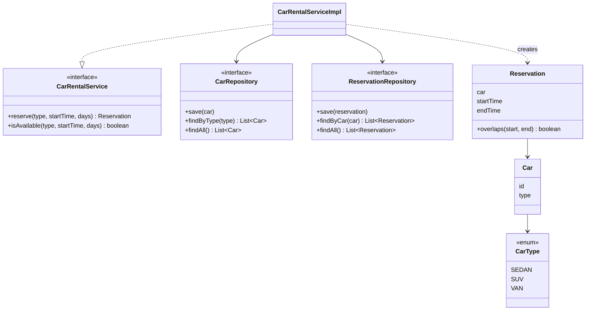
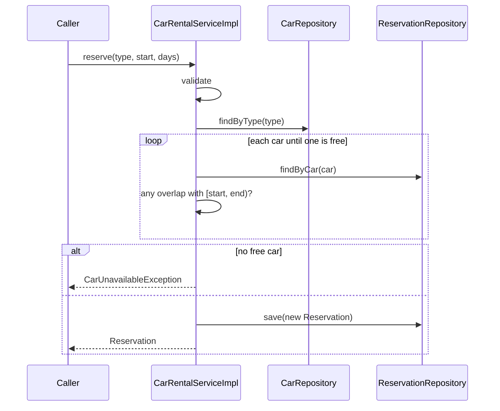

# Design Document: Car Rental System

## 1. Goals and scope

Allow a customer to reserve a car of a given type (sedan, SUV, van) at a desired date and time for a
number of days, with a limited number of cars of each type.

**In scope:** reserve, availability check, per-type limits, validation, thread safety, unit tests.
**Out of scope:** cancellation, pricing and payment, customers/accounts, time zones, durable storage.

## 2. Domain model



| Class | Responsibility |
|-------|----------------|
| `Car` | A physical car: id and type. Equality is by id. Immutable. |
| `CarType` | The three categories of car. |
| `Reservation` | One car for `[startTime, endTime)`. Owns the overlap test. Immutable. |
| `CarRepository` | Stores the fleet. The number of `Car`s of a type *is* the limit for that type. |
| `ReservationRepository` | Stores bookings; can list the bookings of one car. |
| `CarRentalService` | Public API (interface) |
| `CarRentalServiceImpl` | Validation and the booking rule |

## 3. Key design decisions

### 3.1 The fleet is data, not configuration
"The number of cars of each type is limited" is modelled by registering that many `Car` objects. There
is no separate limit counter to keep in sync, and adding a car (or a type) never changes service code.

### 3.2 Half-open time intervals
A reservation covers `[start, start + days)`. The overlap test is one expression,
`a.start < b.end && b.start < a.end`, and back-to-back rentals are naturally allowed.

### 3.3 Booking algorithm
```
reserve(type, start, days):
    validate(type, start, days)
    end = start + days
    car = first car of `type` with no existing reservation overlapping [start, end)
    if none: throw CarUnavailableException
    save Reservation(car, start, days)
```
`isAvailable` runs the same search without saving.

### 3.4 Concurrency
Finding a free car and saving the reservation must be atomic, otherwise two threads could take the same
last car. `reserve` and `isAvailable` are `synchronized` on the service. The in-memory repositories use
`CopyOnWriteArrayList`, so reads and writes are safe on their own. A test races 32 threads for 2 sedans
and asserts exactly 2 succeed.

### 3.5 Layering and dependency inversion
The service depends on the two repository interfaces, so storage can be replaced (for example by a
database) without touching booking rules. `CarRentalService` is an interface, so callers and tests
depend on the contract, not the implementation.

### 3.6 Validation
Bad input fails fast with `InvalidReservationException` (null type or start, `days < 1`, start in the
past). Running out of cars is a different condition and uses `CarUnavailableException`. A rejected
request never changes state.

## 4. Request flow



## 5. Known limitation: first-fit assignment

A booking is assigned to the first free car at booking time and is never moved. In some orderings this
declines a request that could be satisfied by a different assignment of earlier bookings.

Example with 2 sedans (times in days): book `[5.7, 7.7)`, then `[5, 6)`, then `[1, 3)`.
The first goes to car A. The second overlaps it, so it goes to car B. The third goes to car A. Now a
request for `[2.5, 5.5)` overlaps car A's `[1, 3)` and car B's `[5, 6)`, so it is declined, even though
at no moment are both sedans needed by the existing bookings at the same time.

Why it is accepted here: it only arises with several interleaved bookings, it keeps the model
simple (real `Car` objects, one rule), and no requirement calls for optimal packing. 

Options if it ever matters:
* Check capacity per type per instant (count simultaneous reservations against the number of cars of
  that type) and assign the physical car later, at pickup. This is exact.
* Keep per-car assignment but re-pack that type's reservations when a request fails.

## 6. Other assumptions and possible extensions

* `LocalDateTime` is used without a zone; a "day" is a calendar day (`plusDays`).
* The "start in the past" check uses the system clock. Injecting a `Clock` would make it testable
  without future-dated fixtures.
* **Cancellation:** add `remove` to `ReservationRepository` and `cancel(id)` to the service (a
  `Reservation` id would be needed).
* **Pricing:** a pricing strategy called by the service, with the quote stored on `Reservation`.
* **Persistence:** implement the two repository interfaces over a database and make reserve
  transactional.

## 7. Test strategy

| Area | Examples |
|------|----------|
| Booking | each type reservable; overlapping rentals get different cars; car reused for non-overlapping rentals |
| Limits | a type is exhausted after its last car; a type with no cars is never available; types are independent |
| Overlap boundaries | back-to-back allowed in both directions; one minute of overlap rejected; contained and containing ranges rejected |
| Validation | `days < 1`, past start, null type/start, for both `reserve` and `isAvailable`; a rejected request leaves state unchanged |
| Models | `Reservation` interval maths; `Car` equality and validation |
| Concurrency | 32 threads race for 2 sedans: exactly 2 succeed |
